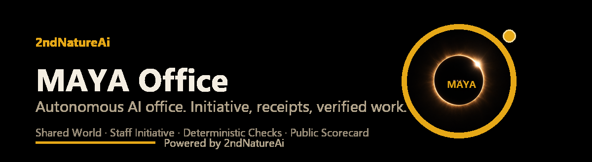
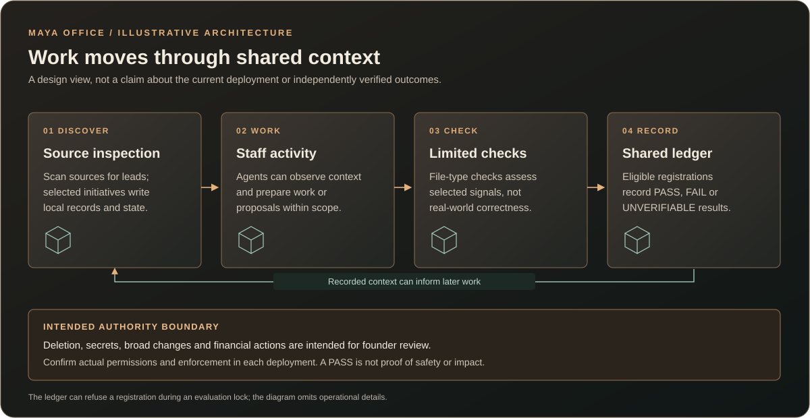

# MAYA Office

<p align="center">
  
</p>

**A multi-agent office experiment with initiative, shared records, and checks.**

MAYA Office is an experiment in multi-agent work. Staff agents can share a persistent world, discover potential work, build on earlier artifacts, and leave records behind. The public test record describes two passes involving ten named staff lanes; it does not establish the current operating roster.

The point is not to make ten chat windows. The point is to see whether a group of AI workers can develop useful division of labor without turning the founder into a full-time traffic controller.

The artifact ledger runs selected deterministic checks when an artifact is registered. Depending on file type, these include syntax checks, pattern-based secret scans, and basic text sanity checks. A PASS means those checks passed; it does not establish that the work is useful, secure, or correct in the real world.

The coordination model is inspired by the [SwarmWorld research paper](https://arxiv.org/abs/2608.26081), which studies agent coordination through a shared simulated environment. Its experimental results are not a benchmark of MAYA Office.

> This repository is the public engineering record for the MAYA Office experiment. It is designed to show the mechanism, the receipts, and the limits.

## What makes it different

Most multi-agent systems coordinate by passing messages around. MAYA Office coordinates through a shared world.

A staff member sees the current ledger, the work already completed, and the artifacts left by other staff. That persistent environment becomes the office memory. A new task can start from an existing result instead of starting from a blank prompt.

The office also allows initiative. Staff can find work without being assigned every move, start a lane-related project, or have a lightbulb moment during a prompted task and propose a better path. That behavior is part of the experiment, not an accidental side effect.

The system still has a hard boundary. Reversible work can move forward. Deletion, secrets, mass changes, and financial actions stay behind a founder decision.

## The loop



The system map illustrates the intended flow across signal intake, shared world state, staff lanes, bounded tools, automated checks, public surfaces, artifacts, and the founder authority boundary. It is an architecture overview, not evidence of the currently running configuration.

Open the [architecture overview](https://maya-platform.github.io/MAYA-Office/system-map.html) for the cleaner rendered version.

## What happens at each stage

1. **The initiative scanner** inspects source material for useful work such as stale records, duplicate material, unfinished markers, or oversized artifacts. It reads those sources without modifying them, then registers selected initiatives and writes local scanner state.
2. **The Swarm Bench** records an initiative or artifact in a linked ledger. Each entry carries identity, sequence, timestamps, parent relationships, and tamper evidence.
3. **Staff observe before they act.** The current world state is available before a turn, so agents can reuse what is already there and develop distinct lanes.
4. **Staff work through bounded tools.** They can research, inspect GitHub, triage email without sending or deleting, write to their own desk, and stage code proposals for review.
5. **The evaluator checks the artifact.** File-type-specific checks produce PASS, FAIL, or UNVERIFIABLE. Hashes support separate integrity checks; neither a PASS nor a matching hash establishes real-world correctness.
6. **The bridge carries the result.** The design includes a bridge to office surfaces, memory, notes, and the work queue. Current integrations and operation require separate verification.
7. **The score summarizes selected signals.** The historical score uses output velocity, a staff-registration proxy, check passes, and inheritance. Modeled cost and recorded real-world effect are separate; a score does not verify those outcomes.

## The components

| File | Role |
| --- | --- |
| `scripts/swarm_bench.py` | Chain-linked artifact ledger and deterministic evaluators |
| `scripts/swarm_initiatives.py` | Source inspection and local registration of discovered initiatives |
| `scripts/swarm_bridge.py` | Moves world state into the office's connected surfaces |
| `scripts/staff_workspace_tools.py` | Bounded staff tools for research, notes, triage, and proposals |
| `scripts/swarm_efficiency.py` | Efficiency score, verdict bands, cost, and value tracking |
| `scripts/doctrine_hitrate.py` | Finds doctrine and skills that need attention |
| `scripts/desktop_scan.py` | Read-only duplicate and clutter scan for founder review |
| `scripts/fleet_metrics_export.py` | Writes the sanitized public fleet snapshot |
| `scripts/founder_meeting.py` | Raises a founder meeting only when decision items accumulate |
| `docs/fleet.html` | Public scorecard displaying an exported metrics snapshot |
| `docs/system-map.html` | Public architecture overview |

## The trust boundary

The office is designed to bound autonomy with explicit authority:

- Research and inspection are read-only.
- Staff notes stay on the staff member's own desk.
- Code proposals are staged for review. Staff code does not self-apply.
- The artifact ledger records the outcome of its file-type-specific checks; those checks do not establish real-world quality or independent verification.
- Reversible work can advance without a founder interruption.
- Deletion, secrets, mass changes, and financial scope escalate.
- A failed check becomes evidence and a repair target, not a success story.

These are intended boundaries. Their operation in a particular deployment requires separate verification. Artifact checks are useful evidence, not a substitute for review of effects and permissions.

## Historical experiment snapshot

The public export is dated **2026-09-13**. It is historical; current Office activity and operating status are not established by this record.

- **89** chain-linked artifacts
- **98.9%** recorded artifact-check pass rate
- **89.9%** staff-registered artifact share (the historical score's autonomy proxy)
- **31.5%** inheritance rate
- **35** initiatives filed, **24** picked up
- **70/100** efficiency score
- **PROMISING** recorded verdict band
- **$7.31** modeled total cost estimate
- **$0.0821** modeled cost estimate per artifact

The sanitized [snapshot](docs/data/fleet-metrics.json) is an exported record, not a live verification or billing statement. The [scoring source](scripts/swarm_efficiency.py) counts artifacts registered by agents other than Hermes and the founder as its autonomy proxy; it cannot establish whether each task was assigned. It estimates cost using assumed VM runtime and token use. The [evaluator source](scripts/swarm_bench.py) defines the limited checks behind the pass rate.

See the [public fleet scorecard](https://maya-platform.github.io/MAYA-Office/fleet.html).

## Test progression

The public record contains two internally scored ten-agent passes. These are reported work signals, not independent comparative benchmarks:

- **Desktop Readiness Pass, 2026-09-11:** **90.0/100** average
- **Research Absorption Pass, 2026-09-12:** **92.6/100** average
- **Movement between those named passes:** **+2.6 points** across the fleet

The wider fleet-level progression across three recorded averages was:

```text
88.0  →  91.0  →  93.3
Pass 1   Pass 2   Pass 3
```

The named pass averages and the wider trajectory are separate records. The latest pass did not move every lane in the same direction, which is exactly why the office keeps the individual numbers.

| Staff lane | Desktop Readiness Pass | Research Absorption Pass | Change |
| --- | ---: | ---: | ---: |
| Herald | 89 | 98 | +9 |
| Shadow | 87 | 94 | +7 |
| Scribe | 86 | 93 | +7 |
| Keira | 84 | 89 | +5 |
| Forge | 92 | 95 | +3 |
| Plumb | 90 | 91 | +1 |
| Recon | 88 | 88 | 0 |
| Specter | 97 | 96 | -1 |
| Chief | 93 | 92 | -1 |
| Nova | 94 | 90 | -4 |

The [test summary](docs/test-results.md) describes the reported work and limits. Its [machine-readable record](docs/data/test-scores.json) provides the scores; the public summary does not contain enough evidence or detail to independently reproduce the assessments. These are work signals, not personality rankings.

## What "working" means

The office is not allowed to call itself successful because it generated a large pile of files.

The experiment clears its INVEST bar only when:

1. The efficiency score holds at **80 or higher** for two consecutive weeks.
2. At least half of the artifacts have a recorded real-world effect, such as a fix applied, a decision informed, or a cleanup completed.
3. The founder is only pulled in for the decisions that genuinely need him.

If the score falls, the system narrows its scope or says the experiment is producing theater. That failure signal is part of the product. It is more useful than a dashboard that always finds a way to look healthy.

## Run the tools locally

The scripts are standard-library Python tools. Start with their built-in help:

```bash
python scripts/swarm_bench.py --help
python scripts/swarm_initiatives.py --help
python scripts/swarm_efficiency.py --help
```

Do not use `--help` with `fleet_metrics_export.py`: it does not have a help
mode. It writes exported metrics and, unless `--no-push` is supplied, can
stage and commit the export and push to `origin/main`. Its commit can include
any other changes already staged in the checkout. Use an isolated clean checkout,
read the script, and review the data and destination before running it. Even
with `--no-push`, it writes the local export files.

The public pages can be served locally with any static file server. For example:

```bash
python -m http.server 8000 --directory docs
```

Then open `http://127.0.0.1:8000/`.

## Repository map

```text
MAYA-Office/
├── docs/
│   ├── data/
│   │   ├── fleet-metrics.json
│   │   └── test-scores.json
│   ├── fleet.html
│   ├── index.html
│   ├── system-map.html
│   └── test-results.md
├── scripts/
│   ├── desktop_scan.py
│   ├── doctrine_hitrate.py
│   ├── fleet_metrics_export.py
│   ├── founder_meeting.py
│   ├── staff_workspace_tools.py
│   ├── swarm_bench.py
│   ├── swarm_bridge.py
│   ├── swarm_efficiency.py
│   └── swarm_initiatives.py
├── LICENSE
└── README.md
```

## Why this matters

The interesting question is not whether an AI can write a report. It can.

The interesting question is whether a group of agents can notice what matters, make useful choices, build on shared evidence, develop their own working styles, and remain honest when the result does not hold up.

MAYA Office is a small public test of that idea. It treats initiative as part of work, verification as part of authorship, and the founder's attention as a scarce resource worth protecting.

## Status

The last public snapshot records a **PROMISING** verdict on 2026-09-13. It does not establish current operating status, independently verified impact, or an INVEST outcome.

Powered by 2ndNatureAi.

## License

MIT
